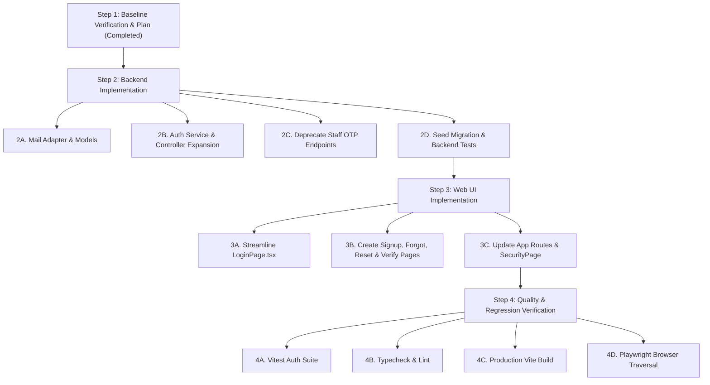

# Authentication Transition Plan: Staff OTP to Email & Password

**Document Version:** 1.0.0  
**Date:** 2026-10-31  
**Status:** Approved / In Progress  

---

## 1. Executive Summary

This document outlines the architectural plan to replace the legacy SMS OTP authentication on the VorldX HR & Admin Web Portal with an enterprise-grade **Email + Password** authentication system. 

The transition encompasses:
- Secure **email + password authentication** with bcrypt hashing, strict strength validation, and account lockout protection.
- Safe **Admin & HR invitation workflow** (Security Model A: First Admin seeded; further staff accounts created via expiring Admin invitation links; open self-signup restricted from privilege escalation).
- Single-use, cryptographically hashed, expiring tokens for **Email Verification**, **Password Reset**, and **Staff Invitations**.
- A pluggable **Mail Adapter System** featuring console printing in development/demo environments and production SMTP delivery.
- Comprehensive UI overhaul of login, signup, password reset, and email verification pages adhering to the VorldX design system with full WCAG AA contrast compliance.
- Strict isolation of the **Employee Mobile App** registration flow, ensuring mobile employee onboarding remains intact and unaffected.

---

## 2. Test Baseline (Pre-Migration)

Before modifying any code, the full test suite was executed to establish the authoritative passing baseline:

```
> @vorldx/shared@0.1.0 test
  ✔ 14 unit tests passed (0 failures)

> @vorldx/api@0.1.0 test
  ✔ 21 test files passed
  ✔ 248 tests passed (0 failures)
  Duration: 83.24s
```

All 21 API test suites (auth, registration, sockets, attendance, wfh, calendar, leave, announcements, enquiries, qr, reports, staff-auth, etc.) passed cleanly.

---

## 3. Inventory & Separation Analysis

### 3.1 What is Shared with Employee Mobile Registration?

| Component | Employee Mobile Registration | Staff Web Portal Authentication | Shared? | Action |
| :--- | :--- | :--- | :--- | :--- |
| **Registration Model** | `RegistrationOtp.ts` (`employeeId`, `otpHash`) | N/A | **No** | **Keep 100% untouched** |
| **Mobile Registration Routes** | `POST /api/auth/register-start`, `register-verify`, `register-complete` | N/A | **No** | **Keep 100% untouched** |
| **User Collection** | `User.ts` (`role: EMPLOYEE`) | `User.ts` (`role: ADMIN`, `HR`) | **Yes (Shared Model)** | Extend schema safely with verification & reset fields. No schema breaking changes. |
| **Session & Tokens** | JWT access tokens & refresh cookies | JWT access tokens & refresh cookies | **Yes (Shared Logic)** | Keep standard JWT verification and refresh handlers intact. |
| **SMS Adapter** | N/A (Email OTP simulated/sent) | `ISmsProvider`, `RealSmsProvider`, `SimulatedSmsProvider` | **No** | SMS provider was used **exclusively** by staff OTP. Remove or deactivate cleanly. |

> [!IMPORTANT]
> The employee mobile registration engine (`RegistrationOtp.ts`, `apps/mobile/src/services/api.ts`, and `auth.controller.ts` registration methods) does **not** rely on `StaffOtpChallenge` or SMS providers. It remains completely preserved and untouched.

---

### 3.2 What Will Be Removed or Deactivated

1. **API Routes**:
   - `POST /api/auth/staff/otp-start`
   - `POST /api/auth/staff/login-request`
   - `POST /api/auth/staff/otp-verify`
   - `POST /api/auth/staff/login-verify`
2. **Backend Models & Services**:
   - `apps/api/src/models/StaffOtpChallenge.ts` (deprecate and remove collection usage)
   - `apps/api/src/services/sms/` (`RealSmsProvider.ts`, `SimulatedSmsProvider.ts`, `ISmsProvider.ts`, `index.ts`)
   - `requestStaffOtp` and `verifyStaffOtp` methods in `apps/api/src/services/staffAuth.service.ts`
3. **Shared Schemas & Sockets**:
   - `StaffOtpStartInputSchema`, `StaffOtpVerifyInputSchema`, `StaffOtpChallengeSchema` in `packages/shared/src/schemas/staffAuth.ts`
   - Socket event constants: `staff:otp_requested`, `staff:otp_sent`, `staff:otp_verified`, `staff:otp_failed`, `staff:otp_locked` in `packages/shared/src/constants/sockets.ts`
4. **Web Frontend**:
   - `apps/web/src/components/auth/OtpInput.tsx` (remove dead component)
   - `LoginPage.tsx`: Remove country code selector, phone number input, OTP 6-box input, OTP timers, SMS resend buttons, and guest socket listeners.
   - `AuthContext.tsx`: Remove `requestStaffOtp` and `verifyStaffOtp` methods and interfaces.
   - `SecurityPage.tsx`: Clean up references to "OTP lockouts" and "OTP elevation".

---

### 3.3 What Will Be Kept or Created

1. **Kept & Enhanced Backend Endpoints**:
   - `POST /api/auth/login` (Standardized on `email` + `password`, supporting generic error messages and lockout)
   - `POST /api/auth/logout` (Invalidates refresh token and clears session cookie)
   - `POST /api/auth/refresh` (Rotates refresh token and issues fresh access token)
   - `GET /api/auth/me` (Returns authenticated user profile and linked employee record)
   - `GET /api/auth/staff/sessions` & `DELETE /api/auth/staff/sessions/:id` (Active session management on Security page)
2. **New Backend Endpoints**:
   - `POST /api/auth/signup` (Email + password registration; accepts optional `inviteToken` for HR/Admin onboarding)
   - `POST /api/auth/verify-email` (Validates single-use token and activates account)
   - `POST /api/auth/resend-verification` (Dispatches a fresh email verification link)
   - `POST /api/auth/forgot-password` (Issues hashed, expiring password reset link via Mail Adapter)
   - `POST /api/auth/reset-password` (Validates reset token and sets new bcrypt password)
   - `POST /api/auth/invite` (Admin-only: generates expiring invitation for HR or Admin role)
   - `GET /api/auth/verify-invite` (Validates an invitation token for the signup UI)
3. **New Mail Adapter Subsystem**:
   - `apps/api/src/services/mail/`
     - `IMailAdapter.ts`: Common interface for email delivery
     - `ConsoleMailAdapter.ts`: Clean terminal output in `development` and `test` environments
     - `SmtpMailAdapter.ts`: Production SMTP delivery using environment variables
     - `index.ts`: Singleton factory with test queue inspection support
4. **New & Updated Web Pages**:
   - `apps/web/src/pages/LoginPage.tsx`: Streamlined corporate email + password login with show/hide password toggle, remember me, forgot-password link, and dark mode contrast compliance.
   - `apps/web/src/pages/SignupPage.tsx`: Self-signup and invite-acceptance page with live password strength indicator and validation.
   - `apps/web/src/pages/ForgotPasswordPage.tsx`: Password recovery request page with anti-enumeration messaging.
   - `apps/web/src/pages/ResetPasswordPage.tsx`: New password entry form with single-use token consumption.
   - `apps/web/src/pages/VerifyEmailPage.tsx`: Token confirmation screen with resend link.

---

## 4. Security Architecture & Specifications

### 4.1 Password Security & Strength Standards
- **Hashing**: `bcryptjs` with a work factor of 10 (`bcrypt.genSalt(10)`).
- **Minimum Length**: 8 characters (maximum 128 characters).
- **Complexity Requirements**: Must contain at least one uppercase letter, one lowercase letter, and one number or special symbol.
- **Data Protection**: Passwords are never logged, never returned in API payloads, and never stored in plain text.

### 4.2 Security Model A: Admin Invitation & Role Safeguards
- **Initial Bootstrap**: Created via `seed.ts` (Super Admin: `admin@vorldx.demo` / `Admin@VorldX2026!`; HR: `hr@vorldx.demo` / `Hr@VorldX2026!`).
- **Staff Provisioning**: To prevent unauthorized privilege escalation, open `POST /api/auth/signup` can **only** create standard `EMPLOYEE` accounts with `PENDING_VERIFICATION` status.
- **Admin/HR Creation**: High-privilege accounts require an **Admin Invitation** (`StaffInvitation` model) generated by an authenticated `ADMIN`. The invite link includes a 32-byte cryptographically secure random token valid for 48 hours. When accepted, the user completes signup directly into the authorized `HR` or `ADMIN` role.

### 4.3 Token Security
- All verification, reset, and invitation tokens are generated as 32-byte cryptographic random hex strings (`crypto.randomBytes(32).toString("hex")`).
- The database stores **only** the SHA-256 hash (`crypto.createHash("sha256").update(token).digest("hex")`).
- Tokens are single-use, strictly bound to the target email, and time-bounded:
  - Password Reset: 1 hour expiry
  - Email Verification: 24 hours expiry
  - Staff Invitation: 48 hours expiry
- Once consumed, tokens are invalidated immediately.

### 4.4 Brute-Force & Enumeration Defenses
- Generic error messages:
  - Login failure: `"Invalid email or password."` (Identical response whether email exists or password is wrong).
  - Forgot password: `"If that email address is registered, a password reset link has been dispatched."` (Zero user enumeration).
- Account Lockout: After 5 consecutive failed login attempts, the account is locked for 15 minutes (`lockoutUntil`).
- Rate limiting: Backed by `authRateLimiter` (Express rate limiter).

---

## 5. Execution Steps



---

## 6. Verification Criteria

1. **Authentication Tests**:
   - Successful login with email + password for seeded Admin and HR accounts.
   - Rejection on invalid password with incremental failed attempt count.
   - Automatic 15-minute lockout on 5 consecutive failures.
   - Signup validation: duplicate email rejection, weak password rejection.
   - Privilege escalation defense: direct signup cannot claim `ADMIN` or `HR` role.
   - Single-use and expiry enforcement on password reset and email verification tokens.
   - Deprecated OTP endpoints (`/api/auth/staff/otp-start`, etc.) return `404 Not Found`.
2. **Regression Tests**:
   - Zero breakages across all 248 existing backend tests.
   - Employee mobile registration endpoints continue functioning without alteration.
   - HR web portal dashboard, attendance ledger, WFH, calendar, announcements, and reports load correctly upon authentication.

